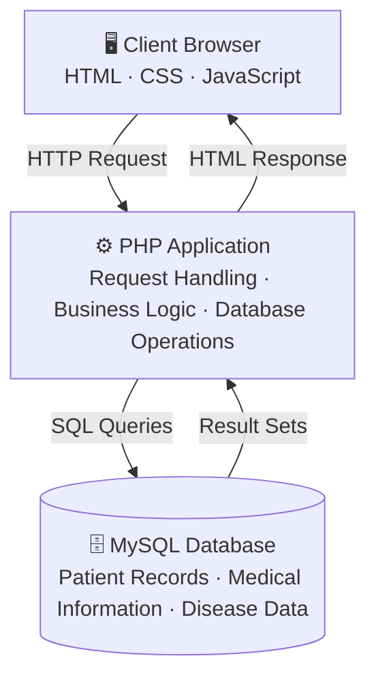

<div align="center">

# 🏥 CMRx

### Central Medical Records & Disease Tracking System

*A centralized, database-driven healthcare information platform for streamlined medical record administration and disease tracking.*

<br>


<br>

[](https://cmrx.rf.gd/cmrx/Homepage.php)
[](https://ahsanhabibkushal.vercel.app/)

</div>

---

## 📑 Contents

[Overview](#-overview) · [Objectives](#-objectives) · [Features](#-core-functional-areas) · [Tech Stack](#️-technology-stack) · [Architecture](#-system-architecture) · [Getting Started](#-getting-started) · [Deployment](#-deployment) · [Roadmap](#️-roadmap) · [Security](#-security--privacy) · [Author](#-author)

---

## 📖 Overview

**CMRx** is a web-based healthcare management application built to address fragmented medical information, inefficient record management, and limited access to organized healthcare data.

It centralizes medical records in a structured relational database and provides a foundation for managing patient information, medical histories, and disease-related records. Built with **PHP and MySQL**, CMRx demonstrates the practical application of database management, server-side programming, and full-stack web development to healthcare information systems.

## 🎯 Objectives

| | Objective | Description |
|:-:|---|---|
| 🗂️ | **Centralized Records** | A unified platform for organizing medical information |
| ⚙️ | **Efficient Data Management** | Less dependence on fragmented, manually maintained records |
| 🔍 | **Information Accessibility** | Simple access to organized records through a web interface |
| 🦠 | **Disease Tracking** | Collection and management of disease-related information |
| 🛡️ | **Data Integrity** | Relational database principles for consistent, structured records |
| 🧱 | **Extensibility** | A foundation for future healthcare analytics and interoperability |

## ✨ Core Functional Areas

<table>
  <tr>
    <td width="50%" valign="top">
      <h4>🩺 Medical Record Management</h4>
      Organizing patient-related medical information within a centralized database environment.
    </td>
    <td width="50%" valign="top">
      <h4>👤 Patient Information Management</h4>
      Maintaining structured patient information to support identification, record administration, and retrieval.
    </td>
  </tr>
  <tr>
    <td valign="top">
      <h4>🦠 Disease Tracking</h4>
      A data-management foundation for recording and examining disease-related information.
    </td>
    <td valign="top">
      <h4>🗄️ Database-Driven Operations</h4>
      MySQL maintains relationships among healthcare records and supports server-side data operations.
    </td>
  </tr>
  <tr>
    <td colspan="2" valign="top">
      <h4>🌐 Web-Based Interface</h4>
      Browser-based interaction through PHP, HTML, CSS, and JavaScript.
    </td>
  </tr>
</table>

> [!NOTE]
> These sections describe the project's primary functional areas. Specific permissions, workflows, and analytical capabilities should be evaluated against the implemented version.

## 🛠️ Technology Stack

| Layer | Technology |
|---|---|
| **Backend** | PHP |
| **Database** | MySQL |
| **Frontend** | HTML5 · CSS3 · JavaScript |
| **Architecture** | Server-rendered, database-driven web application |
| **Hosting** | InfinityFree |
| **Version Control** | Git & GitHub |

## 🏗️ System Architecture

CMRx follows a traditional three-tier web application architecture.



**Architecture principles**

- Separation of presentation, application logic, and data persistence
- Relational storage for structured healthcare information
- Server-side processing through PHP
- Database-backed application workflows

## 🚀 Getting Started

### Prerequisites

- A PHP-compatible web server such as Apache
- PHP
- MySQL or a compatible database server
- XAMPP, WAMP, or an equivalent local environment
- Git

### Installation

**1. Clone the repository**

```bash
git clone https://github.com/AhsanCS64/cmrx.git
```

**2. Move the project into your web server's document root**

For XAMPP on Windows, a typical location is:

```text
C:\xampp\htdocs\cmrx
```

**3. Configure the database**

1. Start Apache and MySQL.
2. Open phpMyAdmin.
3. Create a database for the application.
4. Import the project's SQL schema if one is provided.
5. Update the application's database connection settings with your local credentials.

**4. Launch the application**

```text
http://localhost/cmrx/Homepage.php
```

> [!TIP]
> The database configuration filename, SQL import procedure, and installation path may vary depending on the repository structure.

## ☁️ Deployment

CMRx is deployed on **InfinityFree**, demonstrating how a PHP/MySQL web application can be hosted in an accessible online environment.

**🔗 Live application:** [cmrx.rf.gd/cmrx/Homepage.php](https://cmrx.rf.gd/cmrx/Homepage.php)

For production use involving real patient information, additional security, privacy, backup, access-control, and regulatory requirements must be addressed.

## 🧠 Engineering Concepts Demonstrated

| Concept | Application in CMRx |
|---|---|
| **Relational Database Design** | Structuring healthcare information using related database entities |
| **CRUD Operations** | Creating, retrieving, updating, and deleting application records |
| **Backend Development** | Server-side request processing with PHP |
| **Database Integration** | Connecting application logic to persistent MySQL storage |
| **Full-Stack Integration** | Coordinating browser interfaces, server logic, and database operations |
| **Application Deployment** | Configuring and hosting a dynamic web application |

## 🗺️ Roadmap

- [ ] Role-based access control for patients, physicians, and administrators
- [ ] Comprehensive medical history and appointment management
- [ ] Analytical dashboards for disease trends and healthcare reporting
- [ ] REST API for interoperability with external systems
- [ ] Audit logging for sensitive record operations
- [ ] Improved authentication, authorization, and data protection
- [ ] Standards-based healthcare data exchange, including HL7 FHIR
- [ ] Automated database backups and recovery procedures

## 🔒 Security & Privacy

> [!WARNING]
> Healthcare data requires particularly careful handling. CMRx is an **academic and software engineering project**. Its current deployment should not be assumed to satisfy clinical production requirements or healthcare data protection standards.
>
> **Do not enter real patient information** unless appropriate safeguards, access controls, consent procedures, and legal compliance measures have been independently established.

## 👨‍💻 Author

**H. M. Ahsan Habib Kushal**
Computer Science and Engineering · National Institute of Textile Engineering and Research (NITER), University of Dhaka

[](https://github.com/AhsanCS64)
[](https://ahsanhabibkushal.vercel.app/)

---

<div align="center">

<sub>*Developed as part of an ongoing commitment to building practical, database-driven software solutions for real-world challenges.*</sub>

</div>
